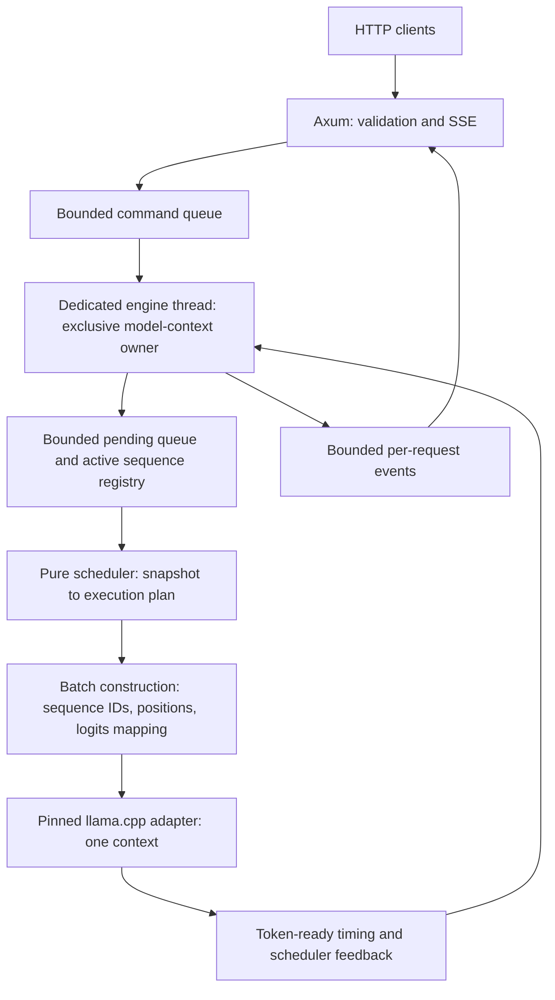

# NiniServe

**A Rust LLM serving engine for Apple Silicon, with application-controlled
continuous batching and an experimental adaptive prefill scheduler.**

NiniServe drives local GGUF models directly through a pinned llama.cpp backend.
Rust code owns request admission, sequence scheduling, execution-batch
construction, cancellation, and token streaming. llama.cpp supplies model
loading, tokenization, sampling primitives, tensor execution, Metal kernels,
and physical KV storage.

The research question is whether adjusting prefill work in response to decode
stalls improves latency without sacrificing throughput or fairness. The first
real-model adaptive experiment is complete: **the frozen controller did not
outperform the fixed-chunk controls.** The implementation and negative result
are both part of the project.

## Current status

| Milestone | Status | Evidence |
| --- | --- | --- |
| Phase 0: backend feasibility | Complete | Two explicit sequences, independent sampling/logits routing, and cleanup in one real context |
| Phase 1: serving foundation | Complete | Local GGUF generation through Axum SSE and an exclusive engine thread |
| Phase 2: continuous batching | Complete | Real concurrent streams, shared-batch traces, cancellation, and slot reuse |
| Phase 3: baseline scheduling | Complete | Three deterministic policies and a real-model W0–W3 benchmark matrix |
| Phase 4: adaptive prefill | Complete; negative performance result | EWMA/hysteresis controller; 285 measured requests across W2/W3/W5 |
| Phase 5: robustness and publishability | In progress | Explicit engine draining, overload/backpressure tests, and benchmark manifests/reports |

Recorded real-model evidence uses **Qwen2.5-0.5B-Instruct Q4_K_M on Apple M2
Metal**, with 25/25 layers offloaded in those experiments. Deterministic mock
tests establish lifecycle and scheduling behavior; they do not prove real-model
correctness or performance. Exact commands, historical checks, and remaining
work are in [the implementation log](docs/IMPLEMENTATION_LOG.md).

## Architecture



Synchronous inference runs outside Tokio HTTP workers. Each active request has
its own logical sequence, sampler, prefill cursor, pending decode token, and
output stream. A backend slot is reused only after successful sequence cleanup.
The backend adapter contains all backend-specific lifetime handling; the engine
and scheduler use model-independent execution plans.

| Crate | Responsibility |
| --- | --- |
| `niniserve-protocol` | Typed IDs, request validation, events, lifecycle transitions |
| `niniserve-backend` | Executor contract, deterministic mock, feature-gated llama.cpp adapter |
| `niniserve-engine` | Model owner, queues, registry, batching, deadlines, cleanup, drain |
| `niniserve-scheduler` | Deterministic baseline policies and adaptive plan/observe controller |
| `niniserve-server` | Axum routes, SSE forwarding, native CLI and signal handling |
| `niniserve-bench` | Real-tokenizer workloads, repeated measurements, CSV/JSON, plots and reports |

## Build and run

The verified development platform is macOS on Apple Silicon with Apple Clang
17, CMake 4.4.4, and Rust 1.97.1. `rust-toolchain.toml`, exact dependency pins,
and `Cargo.lock` fix the toolchain and dependency versions. The backend uses
`llama-cpp-2 = 0.1.159`.

Install Xcode Command Line Tools if needed, then the build tools:

```bash
xcode-select --install
brew install rustup cmake
brew link --force rustup
rustup toolchain install 1.97.1 --profile minimal --component rustfmt,clippy
```

Supply a compatible decoder-only GGUF. [Model setup](models/README.md) includes
the official test fixture's source revision, license, download, and SHA-256.
Weights are ignored by Git and must never be committed.

```bash
cargo run -p niniserve-server --features llamacpp --bin niniserve -- \
  --model models/qwen2.5-0.5b-instruct-q4_k_m.gguf \
  --scheduler fixed-chunk \
  --prefill-chunk-tokens 128 \
  --port 8080
```

In another terminal:

```bash
curl --fail http://127.0.0.1:8080/healthz

curl -N http://127.0.0.1:8080/v1/completions \
  -H 'content-type: application/json' \
  -d '{"model":"local-gguf","prompt":"The capital of France is","max_tokens":12,"temperature":0,"stream":true}'

curl --fail http://127.0.0.1:8080/debug/engine
```

The server binds to `127.0.0.1`; `--port` changes its port. There is no
remote-binding flag or authentication layer. Keep the service local. The debug
endpoint exposes timing and scheduler observations; avoid publishing it or
model-derived output without reviewing the data.

## Scheduling policies

| `--scheduler` | Behavior | Limitation |
| --- | --- | --- |
| `fcfs` | Oldest admitted request finishes before another runs | Head-of-line blocking; intentionally weak baseline |
| `decode-priority` | Decode first, then spend remaining batch capacity on prefill | Can starve prefill under a saturated decode budget; server default |
| `fixed-chunk` | Decode first with a global per-step prefill budget | Chunk size trades prefill latency against decode stalls |
| `adaptive` | Adjust prefill budget using measured server-side decode gaps | Experimental; measured defaults were worse than the best fixed controls |

`--prefill-chunk-tokens N` requires `--scheduler fixed-chunk` and defaults to
128. Actual work also respects remaining prompt length and backend batch
capacity.

To run the adaptive policy:

```bash
cargo run -p niniserve-server --features llamacpp --bin niniserve -- \
  --model models/qwen2.5-0.5b-instruct-q4_k_m.gguf \
  --scheduler adaptive
```

| Adaptive flag | Default |
| --- | ---: |
| `--target-itl-ms` | 75 |
| `--adaptive-min-chunk-tokens` | 32 |
| `--adaptive-max-chunk-tokens` | 512 |
| `--adaptive-initial-chunk-tokens` | 128 |
| `--adaptive-increase-step-tokens` | 32 |
| `--adaptive-decrease-factor` | 0.5 |
| `--adaptive-ewma-alpha` | 0.2 |
| `--adaptive-low-threshold-factor` | 0.85 |
| `--adaptive-high-threshold-factor` | 1.10 |
| `--adaptive-max-prefill-wait-ms` | 500 |

Tuning flags require the adaptive policy. The controller uses a server-side
per-sequence token-ready-gap EWMA, rather than network delivery time. It reduces
the budget above the high threshold and increases below the low threshold.
With no active decoder it allows full safe prefill capacity. An aged active
prefill can reserve progress, but **500 ms is not a hard latency guarantee**:
backend calls are non-preemptive and the rule excludes requests waiting outside
the active set.

## API and resource limits

The completion API is **OpenAI-inspired**, with raw text prompts and streaming
completions only. It does not provide chat templates, `/v1/chat/completions`,
non-streaming responses, tool calls, or full OpenAI SDK compatibility.

| Route | Contract |
| --- | --- |
| `GET /healthz` | 200 when accepting work; 503 during drain or after the engine stops |
| `POST /v1/completions` | Requires `model: "local-gguf"`, `prompt`, positive `max_tokens`, and `stream: true`; optional `temperature` and `top_p` |
| `GET /debug/engine` | Readiness and up to 4096 recent batch/scheduler observations |

Successful SSE streams contain JSON `data:` records with request-specific IDs,
text fragments, and a terminal finish reason followed by `[DONE]`. Cancellation
and timeout use `cancelled` and `timeout` finish reasons. Failures after headers
use `event: error` without `[DONE]`; a disconnected or overflowing output stream
may close without a terminal record.

Invalid generation parameters return 400; an unknown model ID returns 422.
Axum applies its own JSON extraction errors for malformed bodies. A full command
queue or non-ready engine returns **503 before SSE headers**. A full pending
queue is detected by the worker and reported as an SSE error after headers.

| Server default | Limit |
| --- | ---: |
| Active backend sequences | 2 |
| Total context / conservative per-sequence positions | 4096 / 2048 |
| Logical batch / physical microbatch | 512 / 128 tokens |
| Command queue / pending queue | 16 / 16 entries |
| Engine output / SSE forwarding queue | 32 / 8 events per request |
| Prompt bytes / generated tokens | 16 KiB / 256 |
| Request timeout | 120 seconds from engine submission, including command-queue time |

Prompt tokens plus projected evaluated generation positions must fit the
per-sequence limit. These capacities are fixed in the server configuration;
only model path, port, and scheduler settings currently have CLI flags.
The benchmark uses four sequence slots and a different context/queue
configuration, recorded separately in its manifests.

The engine never waits for a client to consume a token. A full output queue
abandons that request and releases its sequence. Disconnect cleanup and deadline
checks happen at engine step boundaries; they cannot interrupt an executing
backend call.

Ctrl-C and, on Unix, SIGTERM stop HTTP admission and begin engine draining.
Work already in the command, pending, or active set follows the existing
completion, overload, timeout, and disconnect rules. `EngineHandle::drain()`
waits asynchronously until the worker has dropped its backend. Repeated drain
calls are safe. There is no hard shutdown wall-clock bound: a stalled backend
call or slow HTTP transport can delay process exit.

## Benchmarks and findings

Build the release harness, run a repeated workload, and generate its trajectory:

```bash
cargo build --release -p niniserve-bench

target/release/niniserve-bench run \
  --model models/qwen2.5-0.5b-instruct-q4_k_m.gguf \
  --scheduler adaptive --workload W5 --repeats 3 \
  --output results/adaptive-w5

target/release/niniserve-bench plot results/adaptive-w5

target/release/niniserve-bench report results/adaptive-w5
```

Available workloads are W0 (serial), W1 (concurrent short prompts), W2
(long-prefill interference), W3 (mixed arrivals), and W5 (load transition).
W4 burst/load-shedding measurement is still pending. The harness measures the
engine directly, so its token-ready latencies exclude HTTP/network delivery.

New runs require an empty output directory and write raw request/token/step
CSVs, metadata, a summary, a SHA-256 manifest, and `report.md`. The manifest
records model/executable/lockfile hashes, source dirtiness, context and engine
settings, exact prompts, sampling, and workload arrivals. Checksum calculation
requires `shasum` (included with macOS) or `sha256sum` and is outside measured
inference. Reports recompute metrics from CSVs and verify recorded input hashes.
Legacy runs are supported with an explicit missing-provenance notice. Generated
results and model-derived prompts remain ignored by Git.

The Phase 4 matrix compared adaptive against fixed chunks 64/128/256/512, with
one workload-shaped warmup and three reset measured trials per configuration.
All **285 measured requests completed**. These are historical observations on
one M2/model, with pooled samples and no confidence intervals:

| Workload | Adaptive output tok/s | Best fixed output tok/s | Adaptive p95 TTFT | Best fixed p95 TTFT |
| --- | ---: | ---: | ---: | ---: |
| W2 | 74.49 | 81.23 (256) | 1441 ms | 834 ms (256) |
| W3 | 78.78 | 88.71 (512) | 5296 ms | 4291 ms (512) |
| W5 | 71.31 | 82.89 (256) | 5450 ms | 3809 ms (512) |

The strongest fixed throughput and TTFT controls may differ. The data does not
support adaptive superiority for this configuration. Controller reaction lag
and frequent fairness overrides were observed; their causal contribution has
not been isolated. See [benchmark methodology and artifacts](docs/BENCHMARKING.md)
and the [complete experiment table](docs/IMPLEMENTATION_LOG.md).

## Verification and development

```bash
cargo fmt --all -- --check
cargo clippy --workspace --all-targets -- -D warnings
cargo test --workspace

# Include the native server binary and all feature-gated targets:
cargo clippy --workspace --all-targets --all-features -- -D warnings
cargo test --workspace --all-features

# Real-backend two-sequence probe; use a local model:
cargo run -p niniserve-backend --features llamacpp --example two_sequences -- \
  models/qwen2.5-0.5b-instruct-q4_k_m.gguf
```

To verify real SSE draining with two active requests and one queued request:

```bash
cargo build --release -p niniserve-server --features llamacpp
python3 scripts/smoke_drain.py \
  --model models/qwen2.5-0.5b-instruct-q4_k_m.gguf \
  --output results/drain-smoke
```

This optional Python 3 standard-library smoke sends SIGTERM after both active
streams produce text and the third request receives headers, checks normal
completion for all three, and checks clean process exit. It requires a free
loopback port (default 18085; override with `--port`) and an empty output
directory. Logs and the JSON result stay under the ignored results directory.

The workspace benchmark enables the native backend, so full workspace checks
need the C/C++ toolchain even when tests use mocks. Ordinary lifecycle, HTTP,
and scheduler tests do not load model weights. The standalone probe and manual
server/benchmark runs supply real-inference evidence; a green mock test suite
does not imply those ran. CI runs formatting, Clippy, and workspace tests on
macOS; real-model checks are local and must be reported separately.

Follow [CONTRIBUTING.md](CONTRIBUTING.md) and [AGENTS.md](AGENTS.md). The
[master spec](NINISERVE_MASTER_SPEC.md) defines phase gates; its proposed tree
and checklist are requirements, not a current implementation inventory.

## Remaining work and boundaries

The next Phase 5 work is capacity-aware admission before streaming headers,
W4 burst measurements, production metrics/structured tracing, a hard HTTP drain
policy, reproducibility automation, and a final performance report with
variance and methodology. Existing debug observations are not a Prometheus
endpoint. Phase 5 and final v1 acceptance remain open.

NiniServe is a single-node research/portfolio engine. It does not implement
custom transformer kernels, physical KV allocation, paged attention, prefix
reuse, distributed serving, or speculative decoding. Performance conclusions
apply only to their measured workloads, model, and hardware.
